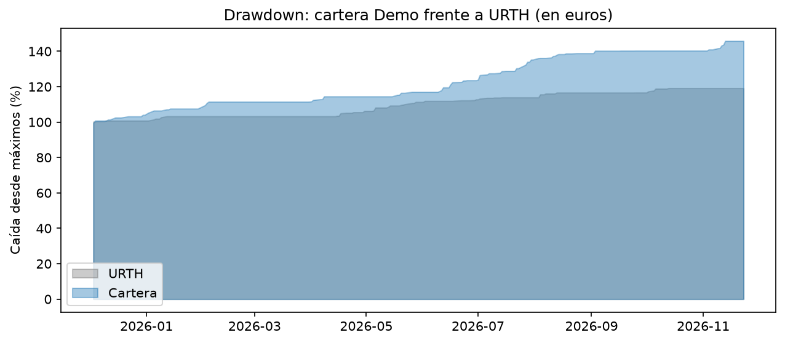
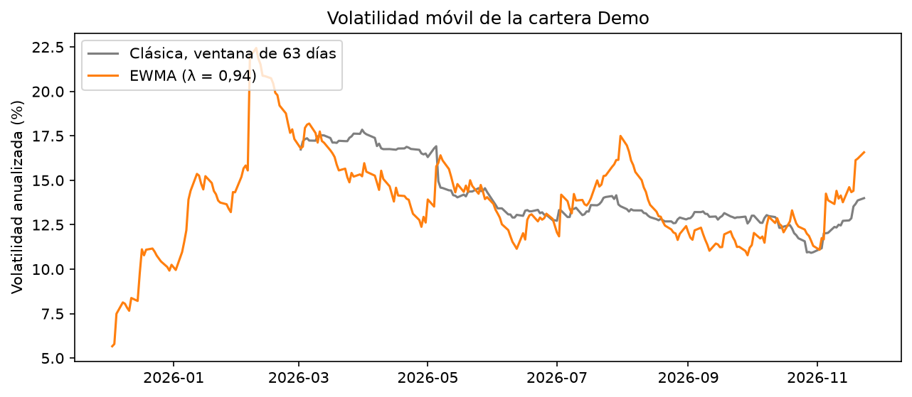
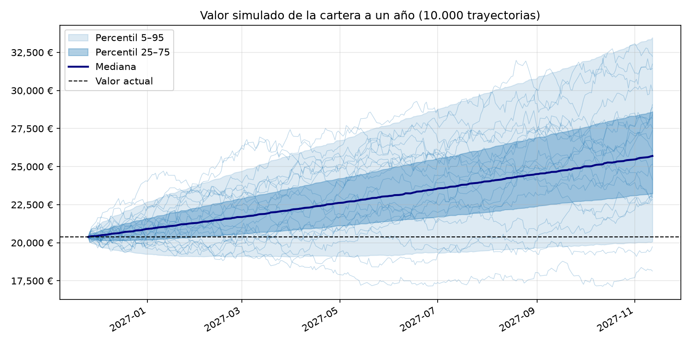

GESTOR DE CARTERAS

En este pequeño proyecto, realizaremos la gestión de diversos activos, desde el cálculo del riesgo, su optimización y backtesting, con el fin de desplegar un dashboard con toda las posiciones y operaciones en Streamlit.

<<En desarrollo>>

## Riesgo de la cartera

**Supuestos del modelo**

- **Comprar y mantener:** no se rebalancea, así que los pesos cambian con el tiempo según lo que suba o baje cada activo.
- **Dividendos reinvertidos:** van incluidos en la rentabilidad total de cada activo.
- **Riesgo divisa incluido:** las rentabilidades están en euros, así que el tipo de cambio ya forma parte del modelo.
- **Parámetros constantes:** la media y la matriz de covarianzas se estiman con 5 años de datos y se mantienen fijas todo el horizonte.
- **Choques normales:** las rentabilidades logarítmicas siguen una normal multivariante, así que el modelo no captura colas gruesas ni agrupamiento de volatilidad. El riesgo extremo está subestimado, como muestra el backtest del VaR normal.